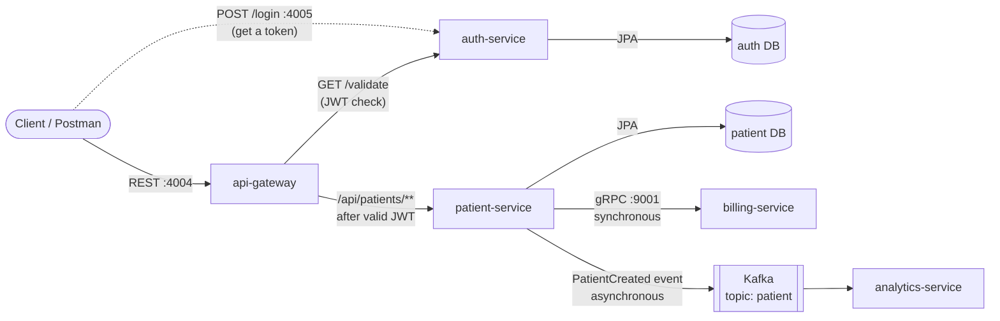

# Patient Management System

A healthcare backend built as **Spring Boot 4 microservices** and run as **Docker** containers. All client traffic enters through a **Spring Cloud Gateway**, which checks every request's **JWT** with a dedicated auth service before routing it. When a patient is registered, patient-service creates a billing account over **gRPC** in the same request, then publishes a `PatientCreated` event to **Kafka** for an analytics service to consume on its own.


---

## Architecture



**Request flow**

1. The client logs in at auth-service (`POST /login`) and receives a signed JWT.
2. Every API call goes to the gateway on port 4004 with `Authorization: Bearer <token>`.
3. The gateway's `JwtValidation` filter calls auth-service's `/validate`, forwarding the same header. A missing or invalid token gets **401** straight from the gateway.
4. With a valid token, the gateway strips `/api` and forwards the request to patient-service.
5. On registration, patient-service calls billing-service over gRPC and **waits** for the account, then publishes a Protobuf event to Kafka and **doesn't wait**.
6. analytics-service consumes the event from the `patient` topic.

| Service | Responsibility | Interface | Port |
|---|---|---|---|
| **api-gateway** | Single entry point; routing; JWT validation filter | REST (Spring Cloud Gateway, WebFlux) | 4004 |
| **auth-service** | Login, JWT issuing and validation; BCrypt passwords | REST | 4005 |
| **patient-service** | Patient CRUD, validation, persistence; Kafka producer | REST, gRPC client | 4000 |
| **billing-service** | Creates billing accounts for new patients | gRPC (Protobuf) | 9001 |
| **analytics-service** | Consumes `PatientCreated` events | Kafka consumer | 4002 |
| **Kafka** | Event broker (topic `patient`) | Kafka protocol | 9092 (containers), 9094 (host) |
| **patient-service-db** / **auth-service-db** | One PostgreSQL database per service | JDBC | 5432 (inside Docker) |

---

## Tech Stack

- **Language:** Java 21
- **Framework:** Spring Boot 4.1, Spring Web MVC, Spring Data JPA, Hibernate 7
- **API gateway:** Spring Cloud Gateway (`spring-cloud-starter-gateway-server-webflux`, Spring Cloud 2025.1) with a custom JWT validation filter using `WebClient`
- **Security:** Spring Security 7, BCrypt password hashing, JWT (JJWT 0.12)
- **Synchronous communication:** gRPC with Protocol Buffers, via Spring Boot's native `spring-boot-starter-grpc-server` (billing) and `spring-boot-starter-grpc-client` (patient)
- **Event streaming:** Apache Kafka (KRaft mode, official `apache/kafka` image) with `spring-boot-starter-kafka`; events serialized with Protobuf
- **Database:** PostgreSQL, one database per service, in Docker; in-memory H2 for local development
- **API docs:** SpringDoc OpenAPI (Swagger UI)
- **Build:** Maven, with `protobuf-maven-plugin` for code generation
- **Containers:** Docker multi-stage builds on Eclipse Temurin images

---

## Key Features

- **Single entry point.** Clients only talk to the gateway, which hides internal service addresses.
- **Centralized authentication.** The gateway validates every protected request's JWT with auth-service, so business services contain no security code.
- **Secure credentials.** Passwords are stored as BCrypt hashes; JWTs are signed with a secret supplied through an environment variable.
- **REST API for patients** with request validation, validation groups and global exception handling.
- **Contract-first gRPC.** `.proto` files define the billing contract, and Java stubs are generated at build time.
- **Event-driven analytics.** Patient registration publishes a Protobuf event to Kafka; analytics-service consumes it in its own consumer group, fully decoupled from the producer.
- **Database per service.** patient-service and auth-service each own a separate PostgreSQL database.
- **Multi-stage Docker builds** and **container networking** by service name on a shared Docker network.

---

## Getting Started

### Prerequisites
- Docker
- Java 21 and Maven, only if you want to run services outside Docker

Start the containers in this order: network → databases and Kafka → billing, auth, patient and analytics services → gateway.

### 1. Create a shared network
```bash
docker network create internal
```

### 2. Start the databases
```bash
docker run -d --name patient-service-db --network internal \
  -e POSTGRES_USER=admin_user -e POSTGRES_PASSWORD=password -e POSTGRES_DB=db \
  -p 5000:5432 postgres:18

docker run -d --name auth-service-db --network internal \
  -e POSTGRES_USER=admin_user -e POSTGRES_PASSWORD=password -e POSTGRES_DB=db \
  -p 5001:5432 postgres:18
```

The credentials above are for local development only. Host ports 5000 and 5001 are only for connecting from your PC; services use `<container-name>:5432` inside Docker.

### 3. Start Kafka (single broker, KRaft mode)
```bash
docker run -d --name kafka --network internal -p 9092:9092 -p 9094:9094 \
  -e KAFKA_NODE_ID=0 \
  -e KAFKA_PROCESS_ROLES=controller,broker \
  -e KAFKA_LISTENERS=PLAINTEXT://:9092,CONTROLLER://:9093,EXTERNAL://:9094 \
  -e KAFKA_ADVERTISED_LISTENERS=PLAINTEXT://kafka:9092,EXTERNAL://localhost:9094 \
  -e KAFKA_LISTENER_SECURITY_PROTOCOL_MAP=CONTROLLER:PLAINTEXT,EXTERNAL:PLAINTEXT,PLAINTEXT:PLAINTEXT \
  -e KAFKA_CONTROLLER_QUORUM_VOTERS=0@kafka:9093 \
  -e KAFKA_CONTROLLER_LISTENER_NAMES=CONTROLLER \
  -e KAFKA_INTER_BROKER_LISTENER_NAME=PLAINTEXT \
  -e KAFKA_OFFSETS_TOPIC_REPLICATION_FACTOR=1 \
  -e KAFKA_TRANSACTION_STATE_LOG_REPLICATION_FACTOR=1 \
  -e KAFKA_TRANSACTION_STATE_LOG_MIN_ISR=1 \
  -e KAFKA_GROUP_INITIAL_REBALANCE_DELAY_MS=0 \
  apache/kafka:latest
```

### 4. Build and run the services
Run each block from the repository root.

**billing-service**
```bash
docker build -t billing-service ./billing-service
docker run -d --name billing-service --network internal -p 9001:9001 billing-service
```

**auth-service**
```bash
docker build -t auth-service ./auth-service
docker run -d --name auth-service --network internal -p 4005:4005 \
  -e SPRING_DATASOURCE_URL=jdbc:postgresql://auth-service-db:5432/db \
  -e SPRING_DATASOURCE_USERNAME=admin_user \
  -e SPRING_DATASOURCE_PASSWORD=password \
  -e JWT_SECRET=<base64-encoded-secret-of-at-least-32-bytes> \
  auth-service
```

**patient-service**
```bash
docker build -t patient-service ./patient-service
docker run -d --name patient-service --network internal -p 4000:4000 \
  -e SPRING_DATASOURCE_URL=jdbc:postgresql://patient-service-db:5432/db \
  -e SPRING_DATASOURCE_USERNAME=admin_user \
  -e SPRING_DATASOURCE_PASSWORD=password \
  -e BILLING_SERVICE_ADDRESS=billing-service \
  -e BILLING_SERVICE_GRPC_PORT=9001 \
  -e SPRING_KAFKA_BOOTSTRAP_SERVERS=kafka:9092 \
  patient-service
```

**analytics-service**
```bash
docker build -t analytics-service ./analytics-service
docker run -d --name analytics-service --network internal -p 4002:4002 \
  -e SPRING_KAFKA_BOOTSTRAP_SERVERS=kafka:9092 \
  analytics-service
```

**api-gateway**
```bash
docker build -t api-gateway ./api-gateway
docker run -d --name api-gateway --network internal -p 4004:4004 \
  -e AUTH_SERVICE_URL=http://auth-service:4005 \
  api-gateway
```

Generate a JWT secret in PowerShell with:
```powershell
[Convert]::ToBase64String((1..32 | ForEach-Object { Get-Random -Maximum 256 }))
```

### 5. Try it

**Log in** to get a token (seeded user):
```http
POST http://localhost:4005/login
Content-Type: application/json

{
  "email": "testuser@test.com",
  "password": "password123"
}
```
Response: `{"token": "eyJhbGciOi..."}`

**Call the API through the gateway** with the token:
```http
GET http://localhost:4004/api/patients
Authorization: Bearer <token>
```

| Request | Expected |
|---|---|
| No `Authorization` header | `401 Unauthorized` |
| Valid token | `200 OK` with the patient list |
| Tampered or expired token | `401 Unauthorized` |

In Postman, add the post-response script `pm.environment.set("token", pm.response.json().token);` to the login request, then use **Bearer Token** `{{token}}` on other requests.

After registering a patient, check analytics-service's log for the consumed event:
```bash
docker logs analytics-service --tail 5
# Received Patient Event: [PatientId=..., PatientName=..., PatientEmail=...]
```

---

## API Reference

### auth-service (port 4005)

| Method | Endpoint | Description |
|---|---|---|
| `POST` | `/login` | Check email and password; returns a signed JWT |
| `GET` | `/validate` | Validate the `Authorization: Bearer` token; `200` if valid, `401` if not |

### patient-service (through the gateway, port 4004)

All routes require `Authorization: Bearer <token>`.

| Method | Endpoint | Description |
|---|---|---|
| `GET` | `/api/patients` | List all patients |
| `POST` | `/api/patients` | Register a patient (creates a billing account and publishes a `PatientCreated` event) |
| `PUT` | `/api/patients/{id}` | Update a patient |
| `DELETE` | `/api/patients/{id}` | Delete a patient |
| `GET` | `/api-docs/patients` | patient-service's OpenAPI JSON |

**Example: register a patient**
```http
POST http://localhost:4004/api/patients
Authorization: Bearer <token>
Content-Type: application/json

{
  "name": "Anil Kumar",
  "email": "anil.kumar@example.com",
  "address": "12 MG Road, Jaipur",
  "dateOfBirth": "1995-01-31",
  "registeredDate": "2025-11-02"
}
```

### billing-service (gRPC, port 9001)

```proto
service BillingService {
  rpc CreateBillingAccount (BillingRequest) returns (BillingResponse);
}
```

Test it with Postman's gRPC client or [grpcurl](https://github.com/fullstorydev/grpcurl):
```bash
grpcurl -plaintext -proto billing-service/src/main/proto/billing_service.proto \
  -d '{"patientId":"123","name":"Anil","email":"anil@example.com"}' \
  localhost:9001 BillingService/CreateBillingAccount
```

### Kafka event: `patient` topic

```proto
message PatientEvent {
  string patientId = 1;
  string name = 2;
  string email = 3;
  string event_type = 4;   // "PATIENT_CREATED"
}
```

---

## Project Structure

```
patient-management/
├── api-gateway/           # Spring Cloud Gateway, routes + JwtValidation filter
├── auth-service/          # Login, JWT, Spring Security, BCrypt
├── patient-service/       # REST API, JPA, gRPC client, Kafka producer
├── billing-service/       # gRPC server
├── analytics-service/     # Kafka consumer
└── README.md
```

Each service has its own `pom.xml`, `src/` and multi-stage `Dockerfile`.

---

## Engineering Notes

Problems solved while building on Spring Boot 4, a newer stack than most tutorials use:

- **gRPC version conflict.** The community `net.devh` starter (built for Spring Boot 3) caused a runtime `AbstractMethodError`. Migrating to Spring Boot's native gRPC starters let Spring Boot manage all gRPC and Protobuf versions.
- **Kafka consumers silently received nothing.** On a single broker, the internal `__consumer_offsets` topic defaulted to replication factor 3 and couldn't be created, so consumer groups never found a coordinator. Setting `KAFKA_OFFSETS_TOPIC_REPLICATION_FACTOR=1` fixed it.
- **Gateway returned 404 for every path.** `routes:` was indented at the same level as `webflux:` in `application.yml`, so no routes loaded. DEBUG logging on `org.springframework.cloud.gateway` exposed it.
- **No `WebClient.Builder` bean in the gateway.** Spring Boot 4 moved WebClient auto-configuration into its own module; adding `spring-boot-starter-webclient` fixed it.
- **Authentication failures surfaced as 500 errors.** The JWT filter validated the token but never forwarded the `Authorization` header to auth-service, which answered 400. Forwarding the header and mapping validation errors to 401 fixed both issues.
- **Version-pinned dependencies** (`spring-kafka 3.x`, SpringDoc 2.x) broke on Spring Boot 4; letting Spring Boot manage versions, or using releases built for it, resolved them.
- **Moved off deprecated images:** `openjdk` → Eclipse Temurin, and Bitnami Kafka → the official `apache/kafka` image.

---

## Roadmap

- [x] **REST patient-service** with validation and OpenAPI docs
- [x] **gRPC billing-service**
- [x] **Kafka event streaming** and **analytics-service**
- [x] **API Gateway** with Spring Cloud Gateway
- [x] **Auth service** with JWT validation at the gateway
- [ ] **Auth routes through the gateway** (`/auth/login` on port 4004)
- [ ] **Integration tests** for login, unauthorized access and patient endpoints
- [ ] **Docker Compose:** start the whole stack with one command
- [ ] **CI/CD pipeline** with GitHub Actions
- [ ] **AWS deployment:** infrastructure as code on LocalStack (VPC, RDS, MSK, ECS, load balancer)

---

## Author

**Anil Singariya** · [GitHub](https://github.com/anilsingaria)
