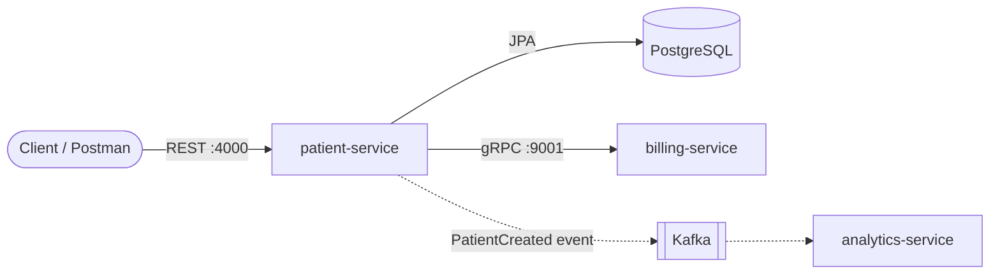

# Patient Management System

A healthcare backend built as **Spring Boot microservices**. Services talk to each other over **gRPC** and run as **Docker** containers. The patient service handles patient records through a REST API. When a patient is registered, it calls the billing service over gRPC to open a billing account automatically.


---

## Architecture



Solid lines are implemented. Dashed lines are on the [roadmap](#roadmap).

| Service | Responsibility | Interface | Port |
|---|---|---|---|
| **patient-service** | Patient CRUD, validation, persistence | REST (JSON) | 4000 |
| **billing-service** | Creates billing accounts for new patients | gRPC (Protobuf) | 9001 |
| **PostgreSQL** | Patient data store | JDBC | 5432 |

---

## Tech Stack

- **Language:** Java 21
- **Framework:** Spring Boot 4.1, Spring Web MVC, Spring Data JPA, Hibernate 7
- **Inter-service communication:** gRPC with Protocol Buffers, via Spring Boot's native `spring-boot-starter-grpc-server` (billing) and `spring-boot-starter-grpc-client` (patient)
- **Database:** PostgreSQL in Docker; in-memory H2 for local development
- **API docs:** SpringDoc OpenAPI (Swagger UI)
- **Build:** Maven, with `protobuf-maven-plugin` for code generation
- **Containers:** Docker multi-stage builds on Eclipse Temurin images

---

## Key Features

- **REST API for patients** with request validation and DTO mapping
- **Contract-first gRPC.** `.proto` files define the service contract, and Java stubs are generated at build time.
- **Synchronous service-to-service calls.** Creating a patient provisions a billing account in the same request.
- **Multi-stage Docker builds.** The JDK and Maven are used only to build, and the runtime image contains just a JRE and the app jar.
- **Container networking.** Services find each other by name on a shared Docker network.
- **Interactive API docs** at `/swagger-ui.html`

---

## Getting Started

### Prerequisites
- Docker
- Java 21 and Maven, only if you want to run the services outside Docker

### 1. Create a shared network
```bash
docker network create internal
```

### 2. Start PostgreSQL
```bash
docker run -d --name patient-service-db --network internal \
  -e POSTGRES_USER=admin_user -e POSTGRES_PASSWORD=password -e POSTGRES_DB=db \
  -p 5432:5432 postgres:18
```

### 3. Build and run billing-service
```bash
cd billing-service
docker build -t billing-service .
docker run -d --name billing-service --network internal -p 9001:9001 billing-service
```

### 4. Build and run patient-service
```bash
cd patient-service
docker build -t patient-service .
docker run -d --name patient-service --network internal -p 4000:4000 \
  -e SPRING_DATASOURCE_URL=jdbc:postgresql://patient-service-db:5432/db \
  -e SPRING_DATASOURCE_USERNAME=admin_user \
  -e SPRING_DATASOURCE_PASSWORD=password \
  -e BILLING_SERVICE_ADDRESS=billing-service \
  -e BILLING_SERVICE_GRPC_PORT=9001 \
  patient-service
```

---

## API Reference

### patient-service (REST)

| Method | Endpoint | Description |
|---|---|---|
| `GET` | `/patients` | List all patients |
| `POST` | `/patients` | Register a patient (also creates a billing account) |
| `PUT` | `/patients/{id}` | Update a patient |
| `DELETE` | `/patients/{id}` | Delete a patient |

**Example request:**
```http
POST http://localhost:4000/patients
Content-Type: application/json

{
  "name": "Anil Kumar",
  "email": "anil.kumar@example.com",
  "address": "12 MG Road, Jaipur",
  "dateOfBirth": "1995-01-31",
  "registeredDate": "2025-11-02"
}
```

Full interactive docs: `http://localhost:4000/swagger-ui.html`

### billing-service (gRPC)

```proto
service BillingService {
  rpc CreateBillingAccount (BillingRequest) returns (BillingResponse);
}
```

You can test it with Postman's gRPC client or [grpcurl](https://github.com/fullstorydev/grpcurl):
```bash
grpcurl -plaintext -proto billing-service/src/main/proto/billing_service.proto \
  -d '{"patientId":"123","name":"Anil","email":"anil@example.com"}' \
  localhost:9001 BillingService/CreateBillingAccount
```

---

## Project Structure

```
patient-management/
├── patient-service/       # REST API, JPA, gRPC client
│   ├── src/main/java/
│   ├── src/main/proto/
│   └── Dockerfile
├── billing-service/       # gRPC server
│   ├── src/main/java/
│   ├── src/main/proto/
│   └── Dockerfile
└── README.md
```

---

## Engineering Notes

- **Migrated to Spring Boot 4's native gRPC support.** The community `net.devh` starter was built for Spring Boot 3 and caused a runtime `AbstractMethodError` from mismatched gRPC versions. The fix was to move to `spring-boot-starter-grpc-server` and let Spring Boot manage all gRPC and Protobuf versions.
- **Replaced the deprecated `openjdk` Docker images** with Eclipse Temurin and split the build into separate build and runtime stages for smaller images.

---

## Roadmap

- [ ] **Kafka event streaming:** publish `PatientCreated` events for asynchronous consumers
- [ ] **analytics-service:** consume patient events
- [ ] **API Gateway:** a single entry point with routing
- [ ] **Auth service:** JWT-based authentication
- [ ] **Docker Compose:** start the whole stack with one command
- [ ] **Integration tests** with Testcontainers
- [ ] **CI/CD pipeline** with GitHub Actions

---

## Author

**Anil Singariya**
