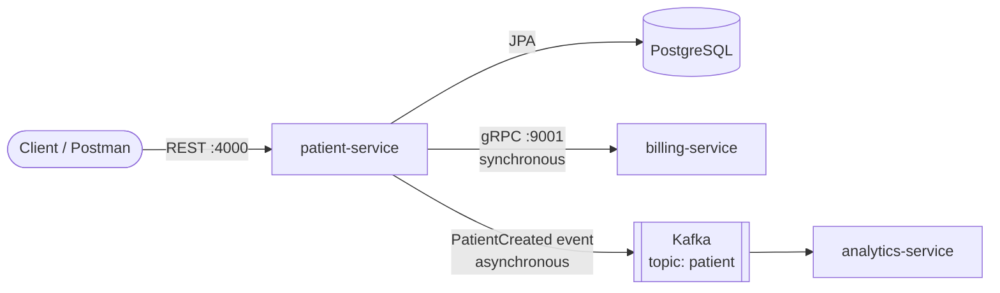

# Patient Management System

A healthcare backend built as **Spring Boot microservices** and run as **Docker** containers. The patient service handles patient records through a REST API. When a patient is registered, it calls the billing service over **gRPC** to open a billing account in the same request, then publishes a `PatientCreated` event to **Kafka**. An analytics service consumes that event on its own, without patient-service knowing it exists.


---

## Architecture



**One patient registration:**

1. `POST /patients` reaches patient-service, which validates and saves the patient.
2. patient-service calls `CreateBillingAccount` on billing-service over gRPC and **waits** for the account.
3. patient-service publishes a Protobuf `PatientEvent` to the `patient` topic and **doesn't wait** for consumers.
4. analytics-service receives the event through its `@KafkaListener` and processes it.

gRPC is used for billing because registration needs a confirmed account immediately. Kafka is used for analytics because it doesn't: events wait in Kafka if analytics is down, and new consumers can subscribe without changing patient-service.

| Service | Responsibility | Interface | Port |
|---|---|---|---|
| **patient-service** | Patient CRUD, validation, persistence; Kafka producer | REST (JSON), gRPC client | 4000 |
| **billing-service** | Creates billing accounts for new patients | gRPC (Protobuf) | 9001 |
| **analytics-service** | Consumes `PatientCreated` events | Kafka consumer | 4002 |
| **Kafka** | Event broker (topic `patient`) | Kafka protocol | 9092 (containers), 9094 (host) |
| **PostgreSQL** | Patient data store | JDBC | 5432 |

---

## Tech Stack

- **Language:** Java 21
- **Framework:** Spring Boot 4.1, Spring Web MVC, Spring Data JPA, Hibernate 7
- **Synchronous communication:** gRPC with Protocol Buffers, via Spring Boot's native `spring-boot-starter-grpc-server` (billing) and `spring-boot-starter-grpc-client` (patient)
- **Event streaming:** Apache Kafka (KRaft mode, official `apache/kafka` image) with `spring-boot-starter-kafka`; events serialized with Protobuf
- **Database:** PostgreSQL in Docker; in-memory H2 for local development
- **API docs:** SpringDoc OpenAPI (Swagger UI)
- **Build:** Maven, with `protobuf-maven-plugin` for code generation
- **Containers:** Docker multi-stage builds on Eclipse Temurin images

---

## Key Features

- **REST API for patients** with request validation and DTO mapping
- **Contract-first gRPC.** `.proto` files define the service contract, and Java stubs are generated at build time.
- **Synchronous service-to-service calls.** Creating a patient provisions a billing account in the same request.
- **Event-driven analytics.** Patient registration publishes a Protobuf event to Kafka; analytics-service consumes it in its own consumer group, fully decoupled from the producer.
- **Multi-stage Docker builds.** The JDK and Maven are used only to build, and the runtime image contains just a JRE and the app jar.
- **Container networking.** Services find each other by name on a shared Docker network.
- **Interactive API docs** at `/swagger-ui.html`

---

## Getting Started

### Prerequisites
- Docker
- Java 21 and Maven, only if you want to run the services outside Docker

Start the containers in this order: network, PostgreSQL and Kafka, then the services.

### 1. Create a shared network
```bash
docker network create internal
```

### 2. Start PostgreSQL
```bash
docker run -d --name patient-service-db --network internal \
  -e POSTGRES_USER=admin_user -e POSTGRES_PASSWORD=password -e POSTGRES_DB=db \
  -p 5432:5432 postgres:18
```

The credentials above are for local development only.

### 3. Start Kafka (single broker, KRaft mode)
```bash
docker run -d --name kafka --network internal -p 9092:9092 -p 9094:9094 \
  -e KAFKA_NODE_ID=0 \
  -e KAFKA_PROCESS_ROLES=controller,broker \
  -e KAFKA_LISTENERS=PLAINTEXT://:9092,CONTROLLER://:9093,EXTERNAL://:9094 \
  -e KAFKA_ADVERTISED_LISTENERS=PLAINTEXT://kafka:9092,EXTERNAL://localhost:9094 \
  -e KAFKA_LISTENER_SECURITY_PROTOCOL_MAP=CONTROLLER:PLAINTEXT,EXTERNAL:PLAINTEXT,PLAINTEXT:PLAINTEXT \
  -e KAFKA_CONTROLLER_QUORUM_VOTERS=0@kafka:9093 \
  -e KAFKA_CONTROLLER_LISTENER_NAMES=CONTROLLER \
  -e KAFKA_INTER_BROKER_LISTENER_NAME=PLAINTEXT \
  -e KAFKA_OFFSETS_TOPIC_REPLICATION_FACTOR=1 \
  -e KAFKA_TRANSACTION_STATE_LOG_REPLICATION_FACTOR=1 \
  -e KAFKA_TRANSACTION_STATE_LOG_MIN_ISR=1 \
  -e KAFKA_GROUP_INITIAL_REBALANCE_DELAY_MS=0 \
  apache/kafka:latest
```

Containers reach Kafka at `kafka:9092`; apps run from your IDE use `localhost:9094`.

### 4. Build and run billing-service
```bash
cd billing-service
docker build -t billing-service .
docker run -d --name billing-service --network internal -p 9001:9001 billing-service
```

### 5. Build and run patient-service
```bash
cd patient-service
docker build -t patient-service .
docker run -d --name patient-service --network internal -p 4000:4000 \
  -e SPRING_DATASOURCE_URL=jdbc:postgresql://patient-service-db:5432/db \
  -e SPRING_DATASOURCE_USERNAME=admin_user \
  -e SPRING_DATASOURCE_PASSWORD=password \
  -e BILLING_SERVICE_ADDRESS=billing-service \
  -e BILLING_SERVICE_GRPC_PORT=9001 \
  -e SPRING_KAFKA_BOOTSTRAP_SERVERS=kafka:9092 \
  patient-service
```

### 6. Build and run analytics-service
```bash
cd analytics-service
docker build -t analytics-service .
docker run -d --name analytics-service --network internal -p 4002:4002 \
  -e SPRING_KAFKA_BOOTSTRAP_SERVERS=kafka:9092 \
  analytics-service
```

### 7. Try it
Send the example `POST /patients` request below, then check analytics-service's log:
```bash
docker logs analytics-service --tail 5
# Received Patient Event: [PatientId=..., PatientName=Anil Kumar, PatientEmail=anil.kumar@example.com]
```

---

## API Reference

### patient-service (REST)

| Method | Endpoint | Description |
|---|---|---|
| `GET` | `/patients` | List all patients |
| `POST` | `/patients` | Register a patient (creates a billing account and publishes a `PatientCreated` event) |
| `PUT` | `/patients/{id}` | Update a patient |
| `DELETE` | `/patients/{id}` | Delete a patient |

**Example request:**
```http
POST http://localhost:4000/patients
Content-Type: application/json

{
  "name": "Anil Kumar",
  "email": "anil.kumar@example.com",
  "address": "12 MG Road, Jaipur",
  "dateOfBirth": "1995-01-31",
  "registeredDate": "2025-11-02"
}
```

Full interactive docs: `http://localhost:4000/swagger-ui.html`

### billing-service (gRPC)

```proto
service BillingService {
  rpc CreateBillingAccount (BillingRequest) returns (BillingResponse);
}
```

You can test it with Postman's gRPC client or [grpcurl](https://github.com/fullstorydev/grpcurl):
```bash
grpcurl -plaintext -proto billing-service/src/main/proto/billing_service.proto \
  -d '{"patientId":"123","name":"Anil","email":"anil@example.com"}' \
  localhost:9001 BillingService/CreateBillingAccount
```

### Kafka event: `patient` topic

```proto
message PatientEvent {
  string patientId = 1;
  string name = 2;
  string email = 3;
  string event_type = 4;   // "PATIENT_CREATED"
}
```

The same `patient_event.proto` lives in patient-service (producer) and analytics-service (consumer), so both sides agree on the message format.

---

## Project Structure

```
patient-management/
├── patient-service/       # REST API, JPA, gRPC client, Kafka producer
│   ├── src/main/java/
│   ├── src/main/proto/    # billing_service.proto, patient_event.proto
│   └── Dockerfile
├── billing-service/       # gRPC server
│   ├── src/main/java/
│   ├── src/main/proto/
│   └── Dockerfile
├── analytics-service/     # Kafka consumer
│   ├── src/main/java/
│   ├── src/main/proto/    # patient_event.proto
│   └── Dockerfile
└── README.md
```

---

## Engineering Notes

- **Migrated to Spring Boot 4's native gRPC support.** The community `net.devh` starter was built for Spring Boot 3 and caused a runtime `AbstractMethodError` from mismatched gRPC versions. The fix was to move to `spring-boot-starter-grpc-server` and let Spring Boot manage all gRPC and Protobuf versions.
- **Let Spring Boot manage Kafka versions.** A hardcoded `spring-kafka:3.3.0` (built for Spring Boot 3) broke dependency resolution. Replacing it with `spring-boot-starter-kafka`, with no version, fixed it.
- **Single-broker Kafka needs replication factor 1 for internal topics.** With the default of 3, Kafka couldn't create `__consumer_offsets`. Producers kept working, but the consumer subscribed and never received messages, because consumer groups couldn't find a coordinator. Setting `KAFKA_OFFSETS_TOPIC_REPLICATION_FACTOR=1` fixed it.
- **Switched to the official `apache/kafka` image** after Bitnami removed its free images from Docker Hub.
- **Replaced the deprecated `openjdk` Docker images** with Eclipse Temurin and split the build into separate build and runtime stages for smaller images.

---

## Roadmap

- [x] **Kafka event streaming:** publish `PatientCreated` events for asynchronous consumers
- [x] **analytics-service:** consume patient events
- [ ] **API Gateway:** a single entry point with routing
- [ ] **Auth service:** JWT-based authentication
- [ ] **Docker Compose:** start the whole stack with one command
- [ ] **Integration tests** with Testcontainers
- [ ] **CI/CD pipeline** with GitHub Actions

---

## Author

**Anil Singariya**
